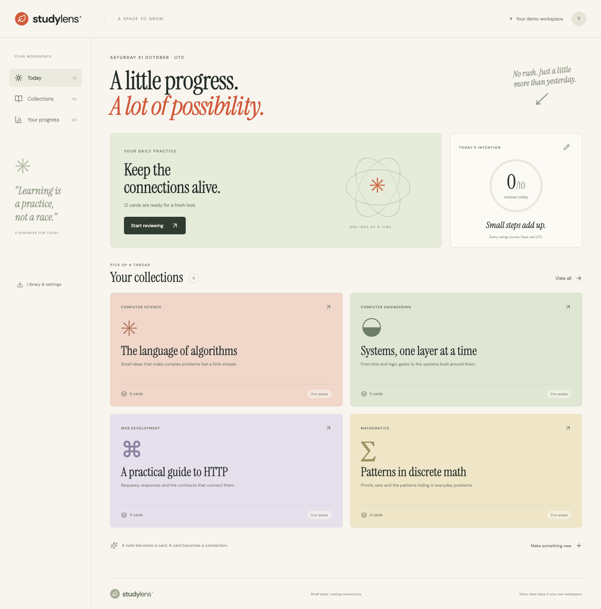

# StudyLens

**An independent learning workspace for notes, flashcards and deliberate daily practice.**

StudyLens brings a small, complete learning loop into one place: collect an explanation, turn it into a question, recall the answer, rate the effort and return when the card is due. The interface uses paper tones, editorial typography and subject covers to make the experience feel like a study journal.



## What you can do

- Organize up to 20 collections with subject labels, descriptions and five cover colours.
- Write plain-text notes, preserve line breaks and turn a note into an editable flashcard draft.
- Create, search, edit and delete question/answer cards with tags.
- Review a due-only queue, reveal each answer and choose Again, Hard, Good or Easy.
- Resume an unfinished review after refreshing the page.
- Set a daily review intention and inspect a 28-day activity calendar, rating distribution and seven-day due forecast.
- Export a portable JSON library and import it into another workspace.
- Try four sample collections covering algorithms, computer engineering, HTTP and discrete mathematics.

Sample collections contain 20 cards and four notes. Their initial schedules demonstrate both due and future cards. They do **not** create fictional review events: progress history begins with the visitor's own ratings.

## The learning loop

1. Open **Try the demo** to create an isolated, cookie-bound workspace.
2. Go to **Collections → New collection** and give a topic a home.
3. Add a note, then select **Turn an idea into a card**. Refine the draft into one clear question and answer.
4. Choose **Review collection**. Attempt recall before selecting **Reveal answer**.
5. Rate your recall. The server updates the schedule and saves the event in the same transaction.
6. Open **Your progress** to see your actual activity. Export the library from **Library & settings** if you want to keep the content.

During review, `Space` reveals an answer and `1`–`4` select the four ratings when keyboard focus is outside a form or button. Visible buttons remain available on touch devices.

## Scheduling model

The scheduler is a small deterministic model inspired by interval-based spaced practice. It is **not** an implementation of FSRS or the complete SM-2 algorithm, and does not estimate memory retention.

A new card starts with interval `0`, ease `2.5` and successful-recall count `0`.

| Rating | Next interval                                                                                         | Other changes                                                                                                                           |
| ------ | ----------------------------------------------------------------------------------------------------- | --------------------------------------------------------------------------------------------------------------------------------------- |
| Again  | 10 minutes                                                                                            | Enter learning; reset successful recalls and interval; reduce ease by 0.20; increment lapses only when failing a card already in review |
| Hard   | At least 1 day; round previous interval × 1.2                                                         | Reduce ease by 0.15; keep successful-recall count                                                                                       |
| Good   | 1 day on first successful recall, 6 on second, then round previous interval × ease                    | Increment successful recalls                                                                                                            |
| Easy   | 4 days on first successful recall; subsequently at least 4 days, round previous interval × ease × 1.3 | Increase ease by 0.15 and increment successful recalls                                                                                  |

Ease stays between `1.3` and `3.0`. Day intervals are capped at `365`. The previous ease factor is used to calculate the next interval before applying the rating's ease change. Due instants use elapsed milliseconds; daily analytics use **UTC calendar dates**. Again cards become eligible after ten minutes in a subsequent review session.

## Engineering decisions

### A review is a versioned snapshot

Starting a review captures at most 50 due cards, ordered by due time and then ID. Each queue entry records the card version. Editing a card or rating it changes that version; an obsolete review cannot overwrite its new state. Only one unfinished review can exist within a workspace. Leaving a session preserves already completed ratings.

The server checks the active session ID, current card ID, reveal state and card version before accepting a rating. The library contains both question and answer content; reveal is an interaction safeguard, not an anti-cheating or answer-secrecy boundary.

### A rating is one atomic transition

A SQLite transaction updates the card's schedule, appends a before/after review event, records the request identity and advances the session. Any failed write rolls back the entire transition. Replaying a completed request key with the same payload does not create another event. Reusing the key with different content returns a conflict. A delayed submission for a previous card cannot rate the next card accidentally.

### Portable content has a narrow contract

The versioned `studylens-library` format exports collection metadata, question/answer/tag content and notes. It excludes cookies, internal IDs, schedules and review history. Import adds collections with fresh IDs and new-card schedules; it does not merge or replace existing collections. The entire import is validated before mutation and committed atomically. Importing the same library twice intentionally creates two copies.

### The demo is bounded and isolated

A random HttpOnly, SameSite=Strict session cookie selects one workspace; only its SHA-256 digest is stored. State-changing requests require a session-derived CSRF token, and browser Origin headers are checked against the configured application origin. Text is rendered as React text rather than injected HTML. Cookies use Secure on the hosted demo.

Workspaces expire after 24 hours of inactivity. API access refreshes activity and cookie expiry. The public server stores SQLite in memory, so a restart clears all workspaces. Optional file-backed SQLite survives process restarts but does not remove workspace expiry. This is an account-free demonstration, with no identity recovery, collaboration or cross-device account sync.

Bounds include 200 active workspaces; 20 collections per workspace; 100 cards per collection and 500 overall; 20 notes per collection; 10,000 review events; 4 MiB per workspace document; and 48 MiB of combined workspace payload. New workspace requests are limited to 20 per IP per 15 minutes. These are defensive limits, not tested traffic-capacity claims.

## Architecture

```text
React + TypeScript
  collections / notes / review / progress
                   |
                   v
Express API -> session + CSRF + Zod validation
                   |
                   v
Workspace store -> review state machine -> deterministic scheduler
                   |
                   v
SQLite transaction: library + schedules + events + request receipts
```

The workspace is stored as a bounded JSON aggregate in SQLite. This keeps content, scheduling and session transitions inside one transaction without splitting a small demo across services. The tradeoff is aggregate writes and single-process operation. It is not designed as a distributed review queue.

| Layer        | Technology                                   |
| ------------ | -------------------------------------------- |
| Interface    | React 19, TypeScript, CSS, Lucide icons      |
| Build        | Vite 6                                       |
| Server       | Node.js 24, Express 5                        |
| Validation   | Zod 4                                        |
| Storage      | Built-in `node:sqlite`, in memory by default |
| Verification | Node test runner, Playwright, GitHub Actions |
| Packaging    | Docker, a single web service                 |

Google Fonts provides DM Sans and Instrument Serif when reachable; local sans-serif and Georgia fallbacks remain usable when offline.

## Run locally

Requires Node.js 24 or newer.

```sh
npm ci
npm run build
npm start
```

Open `http://127.0.0.1:3500`. The default run is disposable and requires no database server or third-party API credentials.

For local persistence, copy `.env.example` to `.env` and set `DATABASE_PATH=./data/studylens.sqlite`. Do not commit `.env` or runtime data. For frontend development, run `npm run dev:api` and `npm run dev` in separate terminals, then open port `3501`.

## Verification

```sh
npm test
npm run build
npm run test:e2e
```

The tests cover interval transitions, due-time eligibility, UTC date changes, idempotent ratings, stale submissions, edit conflicts, rollback, isolation, bounds, expiry, persistence and import/export. The browser scenario creates a collection and note, drafts and reviews a card, reloads progress, exports/imports content and checks a mobile layout.

Details: [architecture and API](docs/ARCHITECTURE.md), [verification evidence](docs/VERIFICATION.md), [portfolio wording](docs/PORTFOLIO.md), [GitHub and demo guide in Russian](docs/GITHUB_UPLOAD_RU.md), [future work](docs/ROADMAP.md).

## Deployment

Build the supplied Dockerfile and expose `PORT` on `HOST=0.0.0.0`. Set `COOKIE_SECURE=true` and `APP_ORIGIN` to the full HTTPS origin, or let the server use `RENDER_EXTERNAL_URL`. Keep `DATABASE_PATH=:memory:` for a disposable public demo. Readiness is available at `/api/health`.

The demo requires one server process and no managed database. Free hosting may sleep between visits; the first visit can take longer. Workspace expiry and export behavior are visible in the application.
